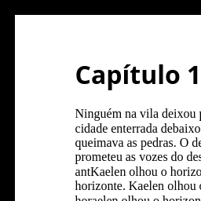
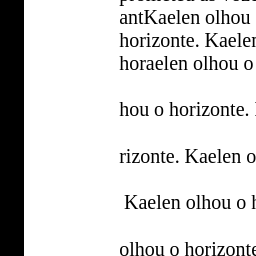
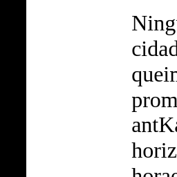
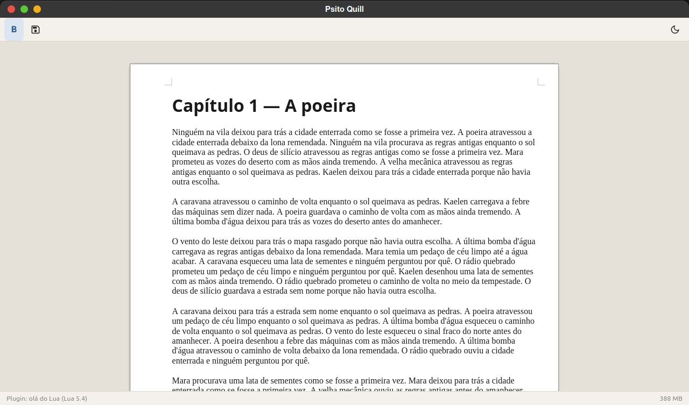
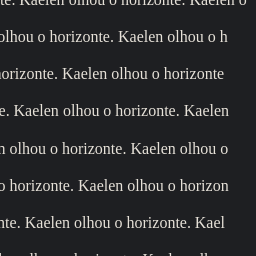

# Fase 0: resultados

A prova do motor (seção 10 do `PLANO.md`), medida em 22/11/2026.

**Veredito: passou no critério de parada.** A latência por tecla ficou em 12 ms no p95 (o corte era 50 ms). A memória com o capítulo ficou em 384 MB de RSS (o corte era 500 MB). Duas metas da seção 8 ainda não foram atingidas: a memória (meta de 320 MB) e o tempo de abrir (meta de 400 ms). Elas estão no fim deste documento, com o que fazer na Fase 1.

## O ambiente

| | |
|---|---|
| Sistema | Ubuntu 24.04 (Linux 7.0), 16 núcleos, 7,2 GB de RAM, X11 (`DISPLAY=:0`) |
| LibreOffice | 24.2.7.2 do sistema (`libreoffice-core`), pela `libmergedlo.so`. Não existe `libsofficeapp.so` no Ubuntu, e o `lok_init` cai na mesclada sozinho |
| Flutter | 3.47.4 estável, Dart 3.13.3, renderizador Impeller (OpenGL ES) |
| Lua | 5.4.6 do sistema (`liblua5.4-dev`) |
| Documento | `test/fixtures/capitulo-30p.docx`: 30 páginas A4, com títulos e cenas, gerado pelo `tool/make_fixture.py` |

O Debian 13 (LibreOffice 25.2) ainda não foi testado. A seção 11 do plano pede esse teste.

## Como medir de novo

```bash
tool/bench.sh            # o motor sozinho e o app inteiro; saída em build/medicoes/ (na Fase 0 era build/fase0/)
./test.sh --integracao   # a pirâmide de testes, com o LibreOffice real
```

O `tool/bench.sh` roda duas medições:
- o **`lok_probe`** usa o motor sem a UI, no mesmo processo, como o app;
- o **`psito-quill --bench`** roda o app de verdade e amostra o USS, o PSS e o RSS pelo `/proc/<pid>/smaps_rollup`.

Nenhum dos dois mexe no mouse nem no teclado.

## Os números

### Memória

| Situação | Motor sozinho (RSS) | App inteiro (RSS) | Meta (seção 8) |
|---|---|---|---|
| Processo antes do motor | 36 MB | 128 MB (Flutter + Impeller) | |
| Motor ligado, sem documento | | 259 MB | |
| Documento vazio | 214 MB | **349 MB** | ≤ 250 MB ❌ |
| As 30 páginas abertas | 250 MB | **384 MB** | ≤ 320 MB ❌ |
| Depois de rolar o documento todo | 251 MB | 389 MB | |
| Depois de digitar 200 teclas | 265 MB | 400 MB | |
| Pico do app no roteiro inteiro | | USS 343 · PSS 352 · RSS 404 MB | |

- **O RSS conta bibliotecas compartilhadas.** Com o app aberto, metade do RSS é de arquivo (198 MB: 83 MB do LibreOffice, 112 MB de outras `.so`, como o Mesa e a ICU). O USS, que conta só o que é do processo, fica em uns 320 MB.
- **O Flutter custa uns 90 MB** antes de qualquer documento, comparando o app (128 MB) com o probe (36 MB).
- **As texturas dos ladrilhos** pesam 32 MB na RAM (128 vagas de 256 KB) e mais o mesmo na GPU, que no Mesa também é RAM.

### Crescimento ao digitar

Depois de abrir as 30 páginas, o probe digitou 4000 teclas, com um Enter a cada 60. O RSS a cada 250 teclas:

```
265 266 269 272 272 272 272 272 273 275 277 277 277 277 277 277  (MB)
```

Ele sobe em degraus e para: ficou em 277 MB nas últimas 1750 teclas. Isso parece o limite de 100 passos de desfazer do LibreOffice, mas não está provado. Só o teste de resistência (30 min digitando, seção 9) diz se a memória fica estável em 4 horas.

### Latência tecla → ladrilho

Medida no nativo: do momento em que a tecla entra na fila do kit até todos os ladrilhos que ela mudou estarem redesenhados, com a textura marcada para o Flutter.

| | Amostras | p50 | p95 | Máximo |
|---|---|---|---|---|
| Probe, 12 teclas/s | 200 | 6,4 ms | 10,9 ms | 44 ms |
| Probe, rajada (uma tecla a cada 15 ms) | 60 | 10,6 ms | 11,7 ms | 12 ms |
| **App, 12 teclas/s** | 200 | **6,9 ms** | **12,3 ms** | 40 ms |

**O que falta para a tela:** até o próximo vsync (0 a 16,7 ms) e o raster do quadro (p95 de 6,2 ms enquanto digita). Nenhum quadro passou de 16 ms. A tecla aparece na tela, no pior caso, uns 35 ms depois; no caso típico, uns 20 ms.

A meta "≤ 16 ms no p95" da seção 8 vale para o motor (12 ms ✅). Para a tela inteira, ela só cabe se o ladrilho chegar antes do vsync.

### Rolar

O app rolou as 30 páginas até o fim e voltou, a ~3000 px/s (67.322 px no total):

| Quadros | fps médio | build p95 | raster p95 | Acima de 16 ms |
|---|---|---|---|---|
| 1341 | **59,8** | 1,8 ms | 5,0 ms | **0** ✅ |

Cada ladrilho de 256×256 custa 1,7 ms no motor. A primeira tela tem 34 ladrilhos e fica pronta em 320 ms.

### Abrir e salvar

| | Motor sozinho | App | Meta |
|---|---|---|---|
| Ligar o LibreOffice (`lok_init`) | 230 ms | | |
| Abrir as 30 páginas | 397 ms | 555 ms | ≤ 400 ms ❌ no app |
| Primeiro ladrilho na tela | | 736 ms | |
| Salvar DOCX | 50 ms | 72 ms | |

### Nitidez a 1x e 1,25x

O motor desenha cada escala na resolução física: a 1,25x, o ladrilho de 256 px cobre 3072 twips, e não 3840 esticados. As letras saem com o desenho do tamanho certo, não com um bitmap ampliado.

| 1x | 1,25x | 2x |
|---|---|---|
|  |  |  |

O preto é a área transparente fora da página (o PPM não tem alfa). No app, ali aparece o fundo do tema.

**O que não foi testado:** a 1,25x de verdade no app, com o GNOME em escala fracionária. O app pede ladrilhos na escala `devicePixelRatio × zoom` e desenha as texturas com `FilterQuality.none`, mas isso só foi conferido a 1x. Fica para a Fase 1.



### Papel escuro (`.uno:ChangeTheme`)

**Funciona na 24.2, mas não sozinho.** O comando existe, mas a 24.2 não traz nenhum esquema escuro. Com `"Dark"` ou `"LibreOffice Dark"`, nada muda.

A solução: o Quill usa um perfil do LibreOffice só dele (`~/.config/psito-quill/lo-profile`) e registra nele dois esquemas, `PsitoQuillClaro` e `PsitoQuillEscuro`, com as cores dos tokens dos temas (`LoProfile.ensureSchemes`).

| Medida (luminância média dos ladrilhos, de 0 a 255) | Claro | Escuro | Claro de novo |
|---|---|---|---|
| App, trocando o tema | 232,6 | **51,2** | 231,9 |



**Uma esquisitice:** o `.uno:ChangeTheme` responde `"success": false` mesmo quando troca o esquema. Por isso o app confere pelos ladrilhos, não pela resposta. A troca também não invalida os ladrilhos sozinha, e o app pede o redesenho (`repaintAll`).

### Lua 5.4

O `plugins/ola/plugin.lua` roda na caixa de areia ao abrir o app e escreve na barra de status: *Plugin: olá do Lua (Lua 5.4)*. Os testes nativos conferem:
- o teto de memória: um laço que aloca até estourar morre com "plugin passou do teto de memória", o estado continua usável e a memória volta a menos de 1 MB;
- a interrupção por instruções: `while true do end` para em milissegundos.

**Um furo encontrado e corrigido:** um plugin podia engolir a interrupção com `pcall` e rodar para sempre (`while true do pcall(function() while true do end end) end`). Agora, depois do limite, o hook roda a cada instrução, e o erro sai do plugin.

## Achados que mudam o plano

1. **O papel escuro precisa do perfil próprio** (acima). Ele já é necessário de qualquer forma, para não brigar com um LibreOffice aberto pelo usuário.
2. **A trava `.~lock` abre o arquivo só para leitura, sem avisar.** Se o Quill morre com um documento aberto, a trava fica ao lado do arquivo. Na próxima vez, com outro perfil, o LibreOffice abre o arquivo só para leitura: as teclas e o negrito são ignorados e nenhum erro aparece. Isso aconteceu de verdade durante as medições.
   - Já feito: fechar a janela fecha o documento antes de sair (`AppLifecycleListener.onExitRequested`), o que apaga a trava. Testado fechando a janela.
   - Falta, na Fase 1: detectar o modo só leitura pelo estado do motor e avisar, e limpar a trava velha quando o processo dono dela não existe mais.
3. **O LOK não pinta fora das páginas.** Sem limpar o buffer antes do `paintTile`, sobram restos do ladrilho anterior. O kit limpa para transparente.

## As metas que faltam, e o que tentar na Fase 1

| Meta | Medido | Ideias, em ordem de custo |
|---|---|---|
| ≤ 320 MB com o capítulo | 384 MB de RSS (USS ~320) | 64 vagas de ladrilho em vez de 128 (−16 MB na RAM e −16 MB na GPU); medir o Skia contra o Impeller; `trimMemory` do LOK ao ficar ocioso; desligar no perfil o que o Writer carrega e o Quill não usa (autocorreção, galeria) |
| ≤ 250 MB com o documento vazio | 349 MB | As mesmas. O piso é 128 MB do Flutter + 214 MB do motor, e talvez esta meta precise ser revista |
| Abrir ≤ 400 ms | 555 ms no app (397 no motor) | Não abrir um documento vazio antes, mostrar o primeiro ladrilho antes do resto, medir sem a troca de tema no meio |

## Testes por nível

| Nível | Ferramenta | Testes | O quê |
|---|---|---|---|
| Unidade | `flutter test test/unit` | 43 | Leitura dos callbacks do LOK, teclas → VCL, `CommandRegistry`, perfil do LibreOffice, `DocumentController` com o kit falso, tokens e contraste, nenhuma cor literal |
| Nativo | GoogleTest (`tool/native-test.sh`) | 21 | Fila do kit (ordem, nunca bloqueia, uma tarefa por vez), cache LRU (memória fixa, vagas visíveis presas, invalidação fina), caixa de areia do Lua (olá, teto, interrupção, `pcall`, sem `io`/`os`, sem bytecode) |
| Widget | `flutter test test/widget` | 30 | Átomos nos temas Claro, Escuro e bisel (mouse, teclado, leitor de tela), a página (ladrilhos, rolar, digitar, Ctrl+N, clique em twips, cursor), a tela do editor (negrito pelo motor, salvar, tema escuro, erro, inglês, rótulos) |
| Integração | `integration_test` com o LOK real | 1 (12 passos) | Abrir as 30 páginas, texturas, rolar, digitar, negrito, salvar e conferir no XML do DOCX, reabrir, Lua (olá e laço interrompido) |
| Ponta a ponta | `tool/bench.sh` | 2 roteiros | O probe e o app inteiro: as tabelas acima |

O `busted` (testes em Lua) não entrou: na Fase 0 não há código Lua além do "olá". Ele entra com a API `psito.*`, na Fase 5.
